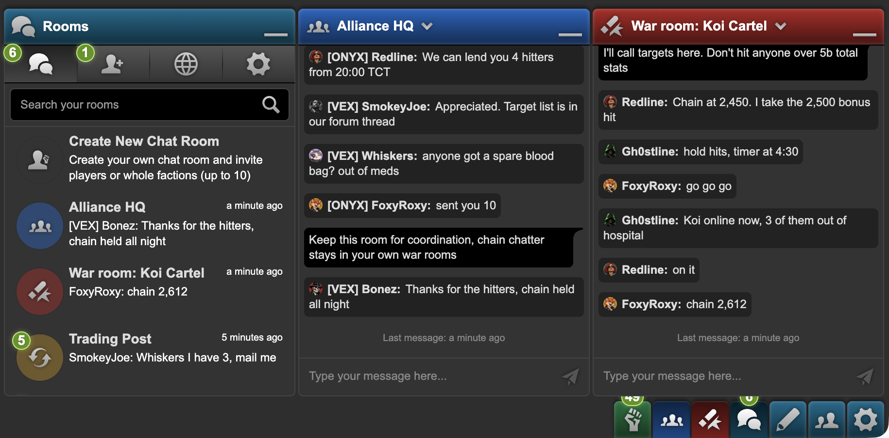
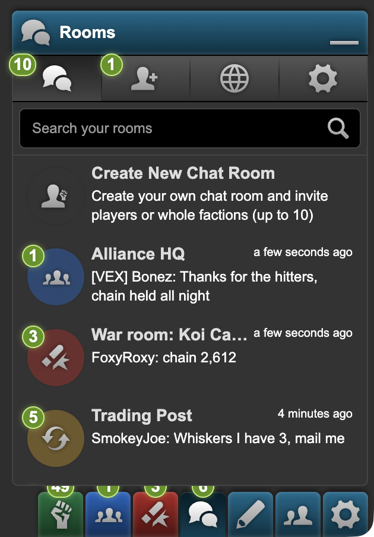
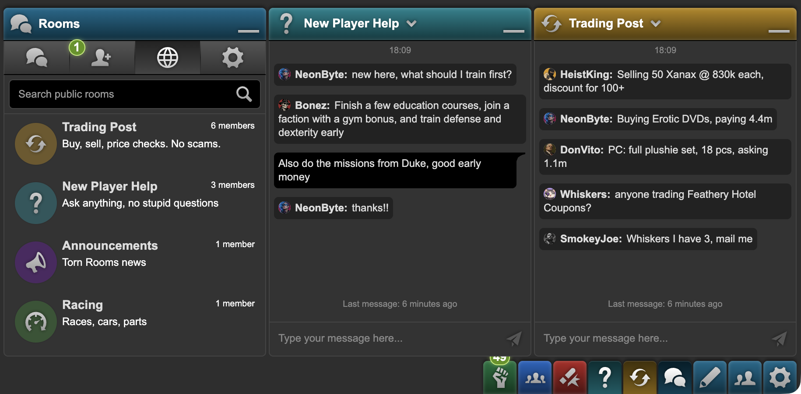
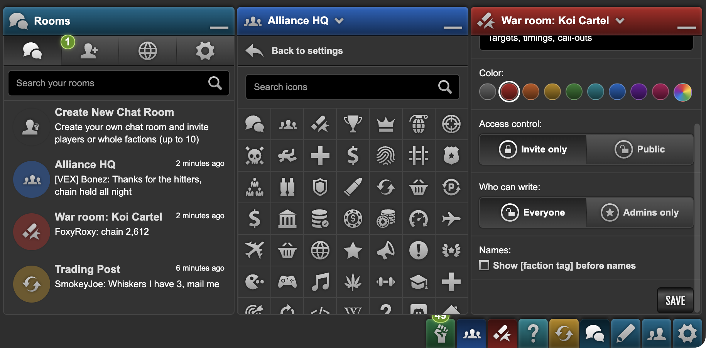
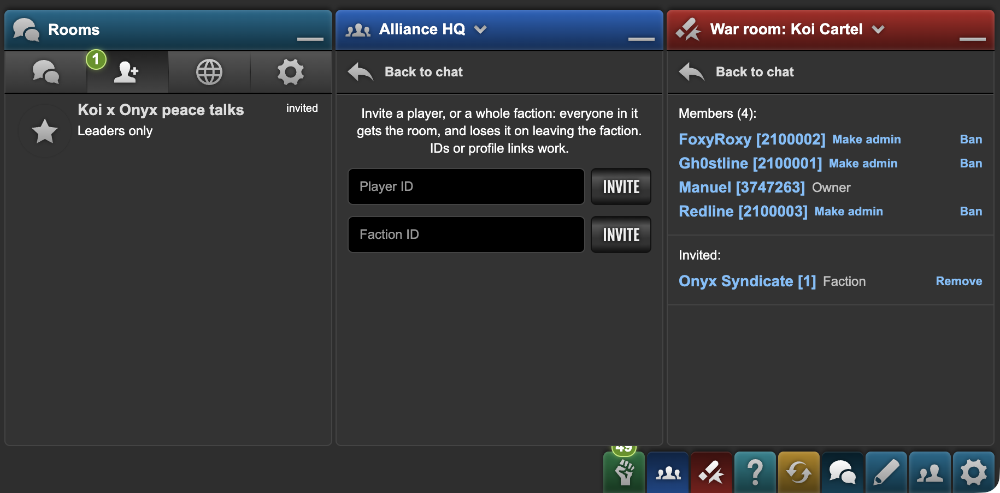
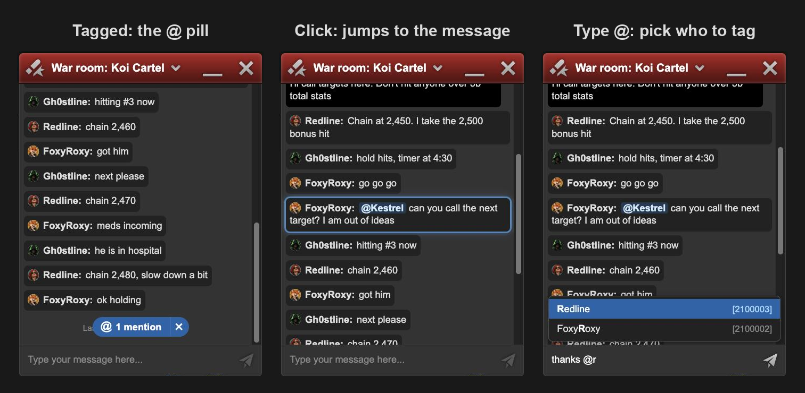

# Torn Rooms

Extra chat rooms inside Torn's own chat bar, drawn with Torn's chat markup and CSS:
private rooms you share with players **or whole factions** (war rooms, alliance rooms),
announcement rooms where only admins write, and public topic rooms anyone can join.



| | |
|---|---|
|  |  |
|  |  |

Screenshots use fictional players, factions and AI-generated avatars (`docs/avatars`), seeded
into a local server with `tools/demo-seed.mjs`.

## Install

Install [Tampermonkey](https://www.tampermonkey.net/), then open `torn-rooms.user.js` (built into
`dist/` by `npm run build`) and confirm. A **Rooms** button appears in Torn's chat bar; log in once
with your own Torn API key (Public access is enough).

What you get: rooms with their own icon and color, shared with players or whole factions; unread
counters on the chat bar; members, invites, admins and bans per room; an optional `[TAG]` before
sender names (handy in alliance rooms); profile pictures only for players who opt in. Hovering a message shows its time and a
reaction bubble with six emojis; reactions sit in the bubble's bottom right corner, hovering one lists who
reacted with it, and a click on one adds or takes back yours. Close a room
with the X in its header, like a private chat; it stays in the **Rooms** list, and a new message
brings its button back.

Tag players with `@Name`: typing `@` lists the room's members (arrows and Enter or Tab to pick). A
tagged player gets an **@ N mentions** pill in the room, Torn's blue "new messages" pill, that jumps to
the oldest message tagging them they have not seen, and an @ beside the room's button and card. A
tag counts as seen once the message has been on screen, in every Torn tab.



## Layout

- `worker/`: Cloudflare Worker + one SQLite Durable Object (`Hub`) holding rooms, access lists, messages and live event streams.
- `userscript/`: Tampermonkey userscript. Builds to `dist/torn-rooms.user.js`.
- `shared/protocol.ts`: wire types used by both.

## How it works

- **Identity.** The player pastes a Torn API key (Public access is enough). The Worker asks Torn
  who owns it (`/v2/user/profile` + `/v2/user/faction`, key in the query string, never the
  Authorization header, see `worker/src/torn.ts`), stores id/name/faction/avatar, and returns a
  6-hour HMAC session token. The key stays in Tampermonkey storage; re-login every 6 hours keeps
  faction membership current. The script also sends the player logged in to Torn in this tab
  (`#torn-user`), and the server refuses a key that belongs to someone else. A modified script can
  fake that value, so it is not proof of identity: it stops bought or leaked keys used with the
  published script. Real proof would need an in-game action (a Torn mail or $1 with a code to a bot
  account); see the discussion in `research/FINDINGS.md`.
  That player id is the only page data the script sends anywhere, and it does so only while the
  Torn tab is actively viewed (visible, and focused or touched): Torn's scripting rules forbid
  sending data from unfocused pages, so an automatic re-login in a background tab waits for the
  player (`whenActive` in `userscript/src/api.ts`).
  Torn PDA fills `###PDA-APIKEY###` automatically.
- **Access.** A private room is visible to its owner, admins, invited players and every member of
  invited factions; leaving the faction removes access at the next login. Public rooms can only be
  created by site admins (`SUPERADMINS` in `worker/wrangler.jsonc`). `postPolicy: admins` makes
  announcement rooms. Rules live in `worker/src/access.ts`.
- **Transport.** Torn's CSP (`connect-src`) blocks `fetch` and `WebSocket` to other hosts, even from
  Tampermonkey's `@sandbox DOM`. Everything therefore goes through `GM_xmlhttpRequest`; live events
  are Server-Sent Events read with `responseType: 'stream'` (`userscript/src/api.ts`).
  Only Tampermonkey is known to stream (`GM_info.scriptHandler`); every other manager, Violentmonkey
  included, polls like Torn PDA. A manager that cannot stream after all (no readable body, or nothing
  for 20 seconds) falls back to polling too.
  Torn PDA routes `GM_xmlhttpRequest` through its native HTTP handler, which returns a response
  only once it is complete, so on PDA the script polls `GET /v1/poll` instead (every 4 s while a
  room panel is open, 15 s otherwise, and not at all in the background: the first poll back
  catches up); the server answers with the same rooms and messages the
  stream would have sent.
- **Look.** `tools/extract-css.mjs` copies the rules of Torn's chat stylesheet that our markup uses,
  renaming every `name___hash` class to `tr_name___hash`, so the rooms look identical but never
  depend on or collide with Torn's live classes. Icons come from Torn's own chat SVGs and icon
  set (`tools/gen-icons.mjs`, `tools/gen-room-icons.mjs`).

- **Abuse limits** (`worker/src/hub.ts`, values in `shared/protocol.ts` `LIMITS`): 5 messages per 5 s,
  60 changes per player per minute, 50 invites per player per hour, 20 logins per IP per 10 minutes, 5 live
  streams per player. Site admins can ban a player everywhere; a ban ends live sessions at once.
  Players Torn has put in federal jail cannot log in. Limit counters live in memory and reset if
  the object restarts; bans are stored.

## Torn API terms (key use disclosure)

| | |
|---|---|
| Data storage | Player ID, name, faction ID and tag; profile picture URL only with the player's consent (off by default, changeable in Settings, revoking removes it from past messages); messages posted, with your name and faction tag at the time (last 5,000 per room); reactions you add to messages and who each message tags, with whether they have seen it (both removed with the message); room membership. |
| Data sharing | Name, avatar, messages and reactions are visible to members of the rooms you post in. Nothing is sold or shared elsewhere. |
| Purpose of use | Proving who you are and which faction you are in, for room access. |
| Key storage & sharing | Kept in Tampermonkey storage on your device. Sent to the Torn Rooms server only to log in (every 6 hours); never stored there or shared. |
| Key access level | Public. |

## Develop

```bash
npm install
npm test                 # Worker + Durable Object tests in workerd (vitest + @cloudflare/vitest-plugin)
npm run typecheck        # tsc-ts for worker and userscript

# local stack: fake Torn API on 8792 (test keys k<uid 7 digits><faction 8 digits>), Worker on 8788
node tools/dev-torn-stub.mjs &
npx wrangler dev --config worker/wrangler.jsonc --port 8788 --ip 127.0.0.1 &
(cd dist && python3 -m http.server 8793 --bind 127.0.0.1) &
tools/dev-install.sh     # builds the dev userscript and opens it so Tampermonkey offers the update
```

`worker/.dev.vars` (not committed) needs `TOKEN_SECRET`, `TORN_API_BASE=http://127.0.0.1:8792/v2`
and `SUPERADMINS`. `tools/chrome-eval.sh` runs JS in the open torn.com Chrome tab (needs Chrome's
View > Developer > Allow JavaScript from Apple Events); `tools/shot.sh` screenshots the Chrome window.

When Torn ships a new chat build, refresh the copied styles: save the new `app.*.css` / `app.*.js`
from `https://www.torn.com/builds/tchat/` into `research/`, then
`node tools/gen-room-icons.mjs && npm run build`.

## Deploy your own

Set `SUPERADMINS` (Torn player ids allowed to create public rooms and ban site-wide) in
`worker/wrangler.jsonc`, then build the script against your Worker with `TR_API_BASE`.

```bash
npx wrangler secret put TOKEN_SECRET --config worker/wrangler.jsonc
npx wrangler deploy --config worker/wrangler.jsonc
TR_API_BASE=https://<your-worker>.workers.dev npm run build   # defaults to the public server
```

## License

MIT, see [LICENSE](LICENSE). The files in `userscript/src/generated/` and the default avatar are
derived from Torn's chat and belong to TORN LTD; they are not covered by the MIT license.
